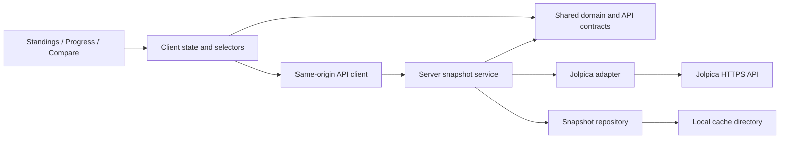

# Architecture Spine — F1 Dashboard

## Design paradigm

Layered modular monolith: one browser application, one server, one season-snapshot owner. [ASSUMPTION] React/TypeScript with the Vite `react-ts` starter; a small Node server using built-in HTTP/fetch/filesystem APIs. This is a fast-path proposal, not a user-approved stack. PRD requirements and the selected Pit Wall UX are adopted; existing UX assumptions remain provisional.



## Invariants & rules

### AD-1 — Dependency boundaries

- **Binds:** All implementation units.
- **Prevents:** Views fetching provider records or implementing conflicting F1 rules.
- **Rule:** Shared domain/contracts import no UI, HTTP or storage modules. The adapter alone parses provider payloads; the server service alone loads/commits snapshots. Views use shared pure selectors over the normalized snapshot. No direct browser-to-Jolpica calls. Charts and tables consume the same selector output; missing values create chart gaps and explicit table cells. DESIGN.md owns Pit Wall tokens/layout; EXPERIENCE.md owns interactions and accessible table equivalents.

### AD-2 — Canonical identity and unavailable values

- **Binds:** Adapter, contracts, selectors, all surfaces.
- **Prevents:** Name-based joins, duplicated sessions, zero-filled missing results.
- **Rule:** Use provider driverId/constructorId, integer season/round, and session kind `gp` or `sprint`. Qualifying means GP qualifying only. Session result key is season + round + kind + driverId; affiliations belong to session entries, not a driver's current team. Standings preserve all source constructor affiliations. Each metric is either `{kind: "value", value: number}` or `{kind: "unavailable", reason: string}`; zero is a value. Preserve source classification text, numeric classification if supplied, and finish status separately; do not turn DNF into an invented finish. Points may be fractional. Round alignment uses the selected season's schedule, sorted by round, including missing/unrun sessions with availability metadata. For a verified non-sprint event, sprint cells say Not applicable; unknown or missing expected sprint data says Unavailable. Never infer an absent sprint is a zero-point sprint.

### AD-3 — Championship authority [ADOPTED]

- **Binds:** FR-2 through FR-5, FR-7; every points selector.
- **Prevents:** Wrong totals from penalties, deductions, historical scoring or double-counted sprints.
- **Rule:** Official per-round driver/constructor standings own cumulative championship points and ranks; final standings use the latest returned official round, with that round retained. Never rank locally or recompute historical points from finishing position. Driver round-earned points sum awarded GP and sprint points; constructor round-earned points sum its session entries. Sum only when required session availability is known; otherwise mark the total unavailable while keeping known components visible. For a driver, every applicable session requires an awarded-points record for that driver; an absent entry remains unavailable even when the endpoint is complete. For a constructor, a session subtotal requires verified complete session results and at least one entry for that constructor, with awarded points present on every such entry; otherwise it is unavailable. A verified non-sprint session is excluded from the round sum rather than represented as a result worth zero. Keep session-earned totals separate from official championship totals; any difference is an adjustment, never silently redistributed. Missing standings stay unavailable rather than using a guessed cumulative sum.

### AD-4 — Season-relative teammates [ADOPTED]

- **Binds:** FR-6, standings annotations, comparison defaults.
- **Prevents:** Current-team lookups and different teammate answers between surfaces.
- **Rule:** Derive shared events from entries where two distinct drivers represent the same constructor in the same session at the same round. First/latest shared rounds determine initial/latest teammate. [ASSUMPTION] If multiple candidates share the boundary round, prefer GP over sprint, then ascending driverId; publish the chosen driver's name, never assume a two-car roster. No shared event leaves B empty. Keep the initial teammate's ranking annotation when it differs from latest. Comparison candidates are the union of selected-season standings, qualifying and result drivers. Both series use the same schedule and metric selectors as Progress.

### AD-5 — Atomic snapshots and explicit refresh [ADOPTED]

- **Binds:** FR-1, FR-8, FR-9; server repository and client state.
- **Prevents:** Partial refresh overwrites, mixed-season responses, incorrect timestamps.
- **Rule:** A snapshot contains schemaVersion, snapshotId, season, refreshedAt (UTC ISO 8601), coverage, schedule, entities, session results, GP qualifying, and official standings by round. Fetch the complete required endpoint/page set into staging, validate it, then atomically replace that season's cache file. A successful empty endpoint is availability information; a failed page/request or malformed required payload rejects the refresh. Preserve the previous snapshot and timestamp on rejection. One in-flight load/refresh per season is shared by duplicate requests. Client commits responses only to their season and ignores obsolete selection requests. Client loads and refreshes share a monotonically increasing per-season operation generation; only the latest generation may commit, and starting refresh invalidates pending reads for that season. All surfaces read one immutable snapshot version. Cache reads never contact upstream; first access on a cache miss may load, thereafter only the explicit Refresh action contacts upstream. No polling, focus refetch or expiry-triggered background fetch.

### AD-6 — Shared application/API contract

- **Binds:** Independently built client surfaces and server handlers.
- **Prevents:** Incompatible endpoints, navigation state and error handling.
- **Rule:** Define contracts first in `shared/`: `GET /api/v1/seasons` returns the verified support manifest; `GET /api/v1/seasons/:year` returns cached snapshot or performs initial load; `POST /api/v1/seasons/:year/refresh` attempts replacement. Success envelope is `{data: T}`; non-2xx error is `{error: {code, message, retryAfterSeconds?}}`. Failed refresh leaves retained data in client state; cold-load failure has no snapshot. Disable duplicate client refresh actions. Validate years against the manifest. [ASSUMPTION] URL query state owns surface, season, standings category, progress entity/metric and comparison A/B; browser Back restores them. Invalid state resets only incompatible selections, direct Compare starts empty, same-driver comparison prompts a different driver. Default season is the latest verified supported season, never the calendar year by assumption. Display timestamps with local timezone explicitly.

### AD-7 — Runtime and provider envelope

- **Binds:** Adapter, deployment, operations.
- **Prevents:** Open-proxy behavior, unsafe cache writes and upstream request storms.
- **Rule:** [ASSUMPTION] Local-first, one Node process on loopback with a writable cache directory; development uses the Vite proxy, production serves built assets and API on one origin. No accounts, database or scheduled jobs. Only the server calls the fixed Jolpica base URL; identify requests with an application/version User-Agent, validate inputs and render provider strings as text. Follow returned pagination metadata to exhaustion, not a presumed page size. Share a process-wide queue capped initially at 2 requests/second and 450/hour; honor 429 Retry-After, use bounded transient retries and timeouts, and fail cleanly when the request budget cannot finish. Both initial loads and refreshes use it. Log operation, season, snapshot ID, duration and error code. Repository writes use atomic replacement; invalid/schema-incompatible files are cache misses. Public/shared hosting requires an access/rate-control decision before exposure; no deployment is performed by this document.

### AD-8 — Verified coverage before claiming support

- **Binds:** FR-1 through FR-9; implementation acceptance.
- **Prevents:** Treating sample calls or an incomplete current season as full coverage.
- **Rule:** Implementation produces a support manifest for verified seasons starting at 2010, with last checked round and known gaps. Audit schedule, qualifying, GP/sprint results and per-round driver/constructor standings, including pagination. Preserve unsupported, future/unrun, successful-empty and request-failure distinctions; never infer all rounds are covered from the maximum returned round alone. Before handoff verify zero versus missing, sprint/no-sprint, fractional points, penalties, midseason team changes, teammate ties, truncated pagination, refresh failure, rapid season switching, delayed cached reads after a successful refresh, and a driver missing a sprint entry while having a GP result. Exercise the full PRD success flow plus Back, keyboard/table access and narrow-screen controls. Tests use saved provider fixtures; live smoke checks establish provider integration, not deterministic unit expectations.

## Stack seed

Upstream `react-ts` template inspected 2026-10-29: React/react-dom **19.3.1**, TypeScript **7.0.2**, Vite **8.3.5**, React plugin **6.1.2**, Oxlint **1.89.0**. These are observed upstream-main baselines, not verified registry releases. At implementation, scaffold the published stable `react-ts` starter, confirm its versions and Node compatibility, and commit the lockfile; installed code then owns versions. Runtime seed: **Node 24 LTS**. Use native CSS and semantic tables; chart dependency selection is deferred until an accessible implementation is chosen.

Verified sources: [starter manifest](https://raw.githubusercontent.com/vitejs/vite/main/packages/create-vite/template-react-ts/package.json), [Vite guide](https://vite.dev/guide/), [Node releases](https://nodejs.org/en/about/previous-releases), [Node HTTP](https://nodejs.org/api/http.html), [Jolpica API/pagination](https://github.com/jolpica/jolpica-f1/blob/main/docs/README.md), [rate limits](https://github.com/jolpica/jolpica-f1/blob/main/docs/rate_limits.md), [driver standings](https://github.com/jolpica/jolpica-f1/blob/main/docs/endpoints/driverStandings.md), [constructor standings](https://github.com/jolpica/jolpica-f1/blob/main/docs/endpoints/constructorStandings.md). Provider limits are changeable configuration, not guaranteed capacity.

## Structural seed

```text
app/
  client/       # shared shell/state; standings, progress, compare; CSS tokens
  shared/       # domain types, API contracts, pure selectors
  server/       # handlers, snapshot service, Jolpica adapter, file repository
  fixtures/     # representative provider responses and expected domain outcomes
.cache/seasons/ # generated, ignored; one validated snapshot per year
```

| Capability | Owner | Rules |
| --- | --- | --- |
| FR-1 season context/coverage | Shell, manifest, snapshot service | AD-2, AD-5–8 |
| FR-2/3 standings | Standings selectors/surface | AD-1–3 |
| FR-4/5 progress | Domain metric selectors, Progress | AD-1–3, AD-8 |
| FR-6/7 comparison | Teammate/alignment selectors, Compare | AD-2–4, AD-6 |
| FR-8/9 refresh/states | Snapshot service, repository, shared shell | AD-5–7 |

## Deferred

- Exact contract fields beyond the invariants: define shared TypeScript types before parallel feature implementation; downstream features must import them rather than invent local shapes.
- Hosting provider, TLS, public access controls, multi-process storage and telemetry: revisit before public deployment; the supported initial envelope is local single-process use.
- Chart/router/test libraries and detailed component tree: implementation chooses within the shared contracts and accessibility requirements.
- Full season audit and published starter resolution: required implementation gates before claiming supported years or freezing dependencies; no full-coverage claim is made here.
- Cross-season comparison, live timing, automatic updates, sprint qualifying, accounts and Wikipedia fallback: outside MVP; revisit only with a scope change.

## Approved first iteration — 2026-10-29

The user approved a reduced first iteration targeting eight hours: only fully verified 2010 and 2021 initially; all required metrics in accessible tables; charts, summary strip, metric previews and broad historical coverage audit deferred. These omissions supersede broader requirements elsewhere in this document for this iteration only. Keep sprint handling, official championship authority, missing-versus-zero, teammate semantics, atomic refresh and failure retention. React/TypeScript/Vite with local Node is accepted. Parallel unattended implementation uses an automated foundation check and final human review, with no intermediate human pause. The canonical contract is _bmad-output/specs/spec-bmad-playground/SPEC.md. Eight hours is a target, not a guarantee; full-MVP direction remains follow-up.

