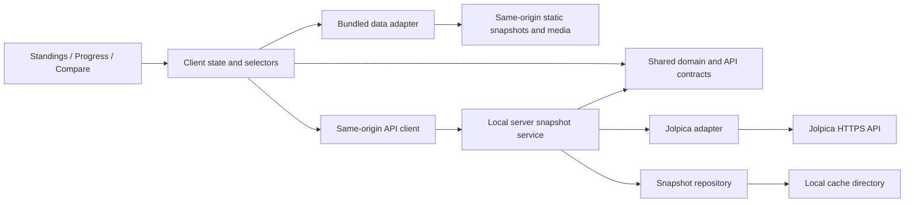

# Architecture Spine — F1 Dashboard

## Design paradigm

Layered application with shared pure domain logic and two build-selected data adapters. The implemented React/TypeScript/Vite client is retained. Local mode uses the existing Node server and writable snapshot repository; bundled ChatGPT Sites mode serves static browser assets, validated snapshots and media. No Node process, writable cache or runtime F1 provider is required by the hosted edition. The approved iteration-two spec supersedes first-iteration feature deferrals; existing UX assumptions remain provisional.



## Current correction authority

The accepted feedback spec and its acceptance companion supersede older starting-grid, visible Better, fallback-only coverage and private-only requirements. Existing code is the shipped baseline, not evidence that these corrections are implemented. This document changes the handoff only; no asset acquisition, code, rebuild or publication is authorized by this update.

## Invariants & rules

Iteration-two scope clarification: AD-5's upstream staging/refresh and AD-6's HTTP endpoints apply to local mode. AD-9 governs hosted reads. AD-7's Node process and provider queue apply only to the local edition. The local snapshot service remains the sole upstream snapshot writer; the exporter copies validated payloads without becoming another provider adapter.

### AD-1 — Dependency boundaries

- **Binds:** All implementation units.
- **Prevents:** Views fetching provider records or implementing conflicting F1 rules.
- **Rule:** Shared domain/contracts import no UI, HTTP or storage modules. The adapter alone parses provider payloads; the server service alone loads/commits snapshots. Views use shared pure selectors over the normalized snapshot. No direct browser-to-Jolpica calls. Charts and tables consume the same selector output; missing values create chart gaps and explicit table cells. DESIGN.md owns Pit Wall tokens/layout; EXPERIENCE.md owns interactions and accessible table equivalents.

### AD-2 — Canonical identity and unavailable values

- **Binds:** Adapter, contracts, selectors, all surfaces.
- **Prevents:** Name-based joins, duplicated sessions, zero-filled missing results.
- **Rule:** Use provider driverId/constructorId, integer season/round, and session kind `gp` or `sprint`. Qualifying means GP qualifying only. Session result key is season + round + kind + driverId; affiliations belong to session entries, not a driver's current team. Standings preserve all source constructor affiliations. Each metric is either `{kind: "value", value: number}` or `{kind: "unavailable", reason: string}`; zero is a value. Preserve source classification text, numeric classification if supplied, and finish status separately; do not turn DNF into an invented finish. Points may be fractional. Round alignment uses the selected season's schedule, sorted by round, including missing/unrun sessions with availability metadata. For a verified non-sprint event, sprint cells say Not applicable; unknown or missing expected sprint data says Unavailable. Never infer an absent sprint is a zero-point sprint.

### AD-3 — Championship authority [ADOPTED]

- **Binds:** FR-2 through FR-5, FR-7; every points selector.
- **Prevents:** Wrong totals from penalties, deductions, historical scoring or double-counted sprints.
- **Rule:** Official per-round driver/constructor standings own cumulative championship points and ranks; final standings use the latest returned official round, with that round retained. Never rank locally or recompute historical points from finishing position. Driver round-earned points sum awarded GP and sprint points; constructor round-earned points sum its session entries. Sum only when required session availability is known; otherwise mark the total unavailable while keeping known components visible. For a driver, every applicable session requires an awarded-points record for that driver; an absent entry remains unavailable even when the endpoint is complete. For a constructor, a session subtotal requires verified complete session results and at least one entry for that constructor, with awarded points present on every such entry; otherwise it is unavailable. A verified non-sprint session is excluded from the round sum rather than represented as a result worth zero. Keep session-earned totals separate from official championship totals; any difference is an adjustment, never silently redistributed. Missing standings stay unavailable rather than using a guessed cumulative sum.

### AD-4 — Season-relative teammates [ADOPTED]

- **Binds:** FR-6, standings annotations, comparison defaults.
- **Prevents:** Current-team lookups and different teammate answers between surfaces.
- **Rule:** Derive shared events from entries where two distinct drivers represent the same constructor in the same session at the same round. First/latest shared rounds determine initial/latest teammate. [ASSUMPTION] If multiple candidates share the boundary round, prefer GP over sprint, then ascending driverId; publish the chosen driver's name, never assume a two-car roster. No shared event leaves B empty. Keep the initial teammate's ranking annotation when it differs from latest. Comparison candidates are the union of selected-season standings, qualifying and result drivers. Both series use the same schedule and metric selectors as Progress.

### AD-5 — Atomic snapshots and explicit refresh [ADOPTED]

- **Binds:** FR-1, FR-8, FR-9; server repository and client state.
- **Prevents:** Partial refresh overwrites, mixed-season responses, incorrect timestamps.
- **Rule:** A snapshot contains schemaVersion, snapshotId, season, refreshedAt (UTC ISO 8601), coverage, schedule, entities, session results, GP qualifying, and official standings by round. Fetch the complete required endpoint/page set into staging, validate it, then atomically replace that season's cache file. A successful empty endpoint is availability information; a failed page/request or malformed required payload rejects the refresh. Preserve the previous snapshot and timestamp on rejection. One in-flight load/refresh per season is shared by duplicate requests. Client commits responses only to their season and ignores obsolete selection requests. Client loads and refreshes share a monotonically increasing per-season operation generation; only the latest generation may commit, and starting refresh invalidates pending reads for that season. All surfaces read one immutable snapshot version. Cache reads never contact upstream; first access on a cache miss may load, thereafter only the explicit Refresh action contacts upstream. No polling, focus refetch or expiry-triggered background fetch.

### AD-6 — Shared application/API contract

- **Binds:** Independently built client surfaces and server handlers.
- **Prevents:** Incompatible endpoints, navigation state and error handling.
- **Rule:** Define contracts first in `shared/`: `GET /api/v1/seasons` returns the verified support manifest; `GET /api/v1/seasons/:year` returns cached snapshot or performs initial load; `POST /api/v1/seasons/:year/refresh` attempts replacement. Success envelope is `{data: T}`; non-2xx error is `{error: {code, message, retryAfterSeconds?}}`. Failed refresh leaves retained data in client state; cold-load failure has no snapshot. Disable duplicate client refresh actions. Validate years against the manifest. [ASSUMPTION] URL query state owns surface, season, standings category, progress entity/metric and comparison A/B; browser Back restores them. Invalid state resets only incompatible selections, direct Compare starts empty, same-driver comparison prompts a different driver. Default season is the latest verified supported season, never the calendar year by assumption. Display timestamps with local timezone explicitly.

### AD-7 — Runtime and provider envelope

- **Binds:** Adapter, deployment, operations.
- **Prevents:** Open-proxy behavior, unsafe cache writes and upstream request storms.
- **Rule:** [ASSUMPTION] Local-first, one Node process on loopback with a writable cache directory; development uses the Vite proxy, production serves built assets and API on one origin. No accounts, database or scheduled jobs. Only the server calls the fixed Jolpica base URL; identify requests with an application/version User-Agent, validate inputs and render provider strings as text. Follow returned pagination metadata to exhaustion, not a presumed page size. Share a process-wide queue capped initially at 2 requests/second and 450/hour; honor 429 Retry-After, use bounded transient retries and timeouts, and fail cleanly when the request budget cannot finish. Both initial loads and refreshes use it. Log operation, season, snapshot ID, duration and error code. Repository writes use atomic replacement; invalid/schema-incompatible files are cache misses. The hosted edition follows AD-9/12 and has no provider traffic; a hosted writable API needs a separate access/rate-control decision; the current shared static Site is governed by AD-12. No deployment is performed by this document.

### AD-8 — Verified coverage before claiming support

- **Binds:** FR-1 through FR-9; implementation acceptance.
- **Prevents:** Treating sample calls or an incomplete current season as full coverage.
- **Rule:** Implementation produces a support manifest for verified seasons starting at 2010, with last checked round and known gaps. Audit schedule, qualifying, GP/sprint results and per-round driver/constructor standings, including pagination. Preserve unsupported, future/unrun, successful-empty and request-failure distinctions; never infer all rounds are covered from the maximum returned round alone. Before handoff verify zero versus missing, sprint/no-sprint, fractional points, penalties, midseason team changes, teammate ties, truncated pagination, refresh failure, rapid season switching, delayed cached reads after a successful refresh, and a driver missing a sprint entry while having a GP result. Exercise the full PRD success flow plus Back, keyboard/table access and narrow-screen controls. Tests use saved provider fixtures; live smoke checks establish provider integration, not deterministic unit expectations.

### AD-9 — Build-selected data source and immutable export [ADOPTED]

- **Binds:** Client loading/state, exporter, media resolver, local and hosted builds.
- **Prevents:** Hosted API fallback, incompatible envelopes, mixed releases and stale cross-release media.
- **Rule:** Shared contracts in `app/shared/contracts.ts` own the discriminated `DataSource` and `BundledManifest`. `loadManifest(): Promise<SupportManifest>` and `loadSeason(year): Promise<SeasonSnapshot>` return domain values; only local mode has `refreshSeason(year)` and unwraps API success/error envelopes. Both modes expose `mediaPath(filename): string`; local resolves local media, bundled resolves media in the validated manifest's immutable release after manifest loading. Views neither construct data URLs nor select adapters. Invalid build configuration fails; bundled failures retry static loading and never switch to local/API mode. Retain operation-generation and response-season guards.

  Bundled JSON is direct `{bundleVersion: 1, exportedAt, seasons: [...]}`; entries extend support metadata with `snapshotId`, `schemaVersion`, `refreshedAt` and relative `assetPath`. Exporter and loader share runtime validation. Resolve assets against the configured same-origin build base and verify season/schema/snapshot/timestamp identity before committing data.

  `scripts/export-site.mjs` exports exactly verified 2010/2021 domain payloads and credited media, accepting original checksum-verified envelopes or explicit sanitized payload inputs. Stage a complete immutable release before atomically promoting its manifest; reject malformed/missing/unverified input, corrupt existing release content and unknown metadata leakage without implicit downloads or fixtures. Data and media belong to one release; use release-specific paths or equivalent cache policy. Preserve source timestamps; export time is separate, and the UI shows selected-season source date/time/timezone. Keep local refresh/build behavior. No service worker or disconnected-browsing guarantee.

### AD-10 — One comparison and evolution policy [ADOPTED]

- **Binds:** Shared comparison policy, summary, round highlights, graphs and evidence tables.
- **Prevents:** Qualifying/grid substitution, conflicting winners, unsupported totals and inaccessible markers.
- **Rule:** `app/shared/comparison.ts` owns directions, eligibility, ties, availability and six fixed category votes: GP race head-to-head, GP qualifying head-to-head, official championship points, best GP finish, best GP qualifying rank and GP DNFs. Higher head-to-head counts/official points win; lower best finish/qualifying rank/DNF count win. Equal weights award one vote per favorable comparable category; tied/unavailable rows award none. Comparable count includes ties. Equal scores draw unless zero categories are comparable, which means insufficient data. Championship rank and margins never break ties. Keep all six rows visible with reasons, sample sizes and head-to-head eligible/tied/excluded rounds; no eligible head-to-head rounds means unavailable.

  Retain schema v1. Best GP qualifying rank uses `QualifyingResult.position` for GP qualifying, independently of starting-grid penalties: qualifying 2 followed by grid 7 remains 2. Require a complete qualifying session and an authoritative numeric record for that driver at every scheduled GP before reporting an unqualified season best; otherwise return a qualifying-specific unavailable reason and coverage count. Do not add grid fields, substitute race/sprint ranking or retain the missing-starting-grid schema explanation. Qualifying head-to-head is a separate category, not a duplicate best-rank count or seventh row.

  Preserve authoritative numeric classification plus source status and GP/sprint separation. Best finish/DNF still require authoritative driver GP records across every scheduled GP; absence does not prove nonparticipation, including substitute-driver gaps. An explicit tested retirement-status allowlist excludes DNS, disqualification, finished/lapped finishes; unknown status makes DNF totals unavailable. Numeric classification never overrides recognized retirement. Retain frozen fixtures for classified retirement, unknown status, absent result and replacement drivers; no substring/position-based retirement inference.

  Summary and detail consume the same shared outcomes. Favorable values use a visible tick and highlight without repeated visible Better wording; screen-reader text identifies driver, metric and favorable direction, and the decorative tick is hidden from assistive technology. Tied/unavailable values receive no favorable tick/highlight. Bars require comparable nonnegative counts/points and positive sum; ranks use markers, zero/zero/negative/missing values use text. Evolution and its semantic table share pure selector output, separate driver/constructor categories and GP/sprint ranks, cumulative-points default, chronological rounds, gaps and rank 1 at top. Preserve stable named styles, URL/Back selections, keyboard/pointer inspection and mobile reflow.

### AD-11 — Bundled media identity, coverage and provenance [ADOPTED]

- **Binds:** Asset acquisition, identity mappings/rendering, credits, coverage evidence and exporter.
- **Prevents:** Fallback-only completion, wrong historical identities, uncredited assets and runtime external images.
- **Rule:** Target every driver/season and constructor/season represented in the verified 2010/2021 snapshots with actual verified photographs and season-appropriate historical logos. `app/client/media.ts` owns explicit canonical identity/season mappings to local `public/media/` files. Do not use name-based joins, unrelated current constructors, generated likenesses or generated logos. A verified photograph may serve multiple applicable seasons; disclose its date or unknown without implying selected-season photography. Retain all relevant affiliations.

  `public/media/credits.json` records source URL, creator, reuse terms/license and URL, required attribution, identity, applicable seasons, filename, photo date or unknown and crop notes. Ship usable credited files locally with the same data release under AD-9; validate mappings, provenance and referenced file integrity. Missing mapping, unusable license or load failure renders named initials/team text in stable frames without blocking analysis; no external image/font/data calls in hosted mode.

  Before independent acquisition/export work, freeze the media metadata validation and coverage-counting contract. The coverage slot is `(kind, canonical identity, season)`, with kind `portrait` or `constructor`; one mapped valid file counts at most once per slot, even when reused across seasons. Each slot is either mapped or an investigated fallback, never both. Acquisition, rendering, exporter validation and the coverage report must agree on these identities and fields.

  `_bmad-output/implementation-artifacts/second-iteration-media-coverage.md` inventories every snapshot identity/season, mapped file or individually investigated exception, attempted source URLs, specific blocker and visual-check outcome. Report actual mapped-image counts over total identities per season separately for logos/photographs; count fallbacks separately. Generic not-vetted reasons and passing fallback tests do not establish acquisition coverage. Maximize coverage; no reduced percentage is pre-approved. User review of remaining exceptions is part of acceptance. Verify actual face/logo identity, historical suitability, legibility and crop/containment at desktop/narrow layouts; keep coverage evidence separate from the deployment artifact.

### AD-12 — Existing shared static Sites release [ADOPTED]

- **Binds:** Sanitized source preparation, packaging, publication, audience and evidence.
- **Prevents:** Leaked local inputs, replacement Site registration, audience regression and false deployment claims.
- **Rule:** Reuse the existing returned `project_id` in the isolated source checkout's `.openai/hosting.json` with `static.directory: dist`; inspect/recover existing identity after uncertainty, never invent IDs or register a replacement. Preserve the current user-authorized anyone-with-link audience. Use the installed Sites source helper and deployment operation appropriate to the confirmed audience; do not revert to owner-private or broaden access beyond current authorization.

  Keep original local builds/server. Isolated source contains browser/shared source, required build inputs, sanitized validated payloads and attributed media; exclude local server assumptions, raw envelopes, credentials, logs, original Git metadata and unrelated files. Its default `npm run build` performs validated export and hosted build without Node API or hidden local files. Shared static reads make no provider calls and need no new account/backend/Worker/database system.

  Rebuild/publication follows explicit execution authorization, not approval of these document edits. Synchronize exact source and package its matching commit/archive. Preserve returned project/version/deployment IDs, resume pending deployment and record terminal result; claim publication only on returned terminal success. Record URL and current sharing evidence in `second-iteration-verification.md`, separately from historical release checks. Validate qualifying/markers/actual imagery coverage plus regressions in both modes and bundled behavior with external requests blocked. Local refresh changes no hosted data until another validated release. Sites still requires network access.

## Stack seed

Retain the installed React **19.3.1**, TypeScript **7.0.2**, Vite **8.3.5** and React plugin **6.1.2** from `package.json`/lockfile; the repository declares Node **>=24.0.0**. This update introduces no dependency or version change. Native CSS and semantic tables remain. Chart implementation must satisfy AD-10 before choosing any additional dependency.

Reality checks for this update: existing `app/shared/contracts.ts`, `app/client/App.tsx`, `vite.config.ts`, `package.json`, and the installed Sites `SKILL.md` (static manifest, source packaging, confirmed-audience deployment and terminal-result contracts). Earlier provider research remains historical context in the memlog; this update does not reassert current provider limits.

## Structural seed

```text
app/
  client/       # shared shell/state; standings, progress, compare; CSS tokens
  shared/       # domain types, API contracts, pure selectors
  server/       # handlers, snapshot service, Jolpica adapter, file repository
  fixtures/     # representative provider responses and expected domain outcomes
.cache/seasons/ # generated, ignored; one validated snapshot per year
```

| Capability | Owner | Rules |
| --- | --- | --- |
| FR-1 season context/coverage | Shell, manifest, snapshot service | AD-2, AD-5–8 |
| FR-2/3 standings | Standings selectors/surface | AD-1–3 |
| FR-4/5 progress | Domain metric selectors, Progress | AD-1–3, AD-8 |
| FR-6/7 comparison | Teammate/alignment selectors, Compare | AD-2–4, AD-6 |
| FR-8/9 refresh/states | Snapshot service, repository, shared shell | AD-5–7 |
| Iteration-two summary/highlights | Shared comparison policy, Compare | AD-2/3, AD-10 |
| Iteration-two evolution | Shared selectors, chart and evidence table | AD-1–3, AD-10 |
| Iteration-two media | Identity mapping, bundled credits/assets | AD-11 |
| Iteration-two bundled hosting | Data-source adapter, exporter, Site release | AD-9, AD-12 |

## Deferred

- Exact contract fields beyond the invariants: define shared TypeScript types before parallel feature implementation; downstream features must import them rather than invent local shapes.
- Multi-process writable storage, public writable APIs and telemetry remain deferred. Shared static ChatGPT Sites hosting is adopted by AD-9/12; Sites enforces the existing audience rather than a new application login.
- Chart/router/test libraries and detailed component tree: implementation chooses within the shared contracts and accessibility requirements.
- Additional seasons require a new coverage audit. Retain verified 2010/2021 only; prior release evidence does not establish correction acceptance.
- Cross-season comparison, live timing, automatic updates, sprint qualifying, accounts and Wikipedia fallback: outside MVP; revisit only with a scope change.


## Handoff status

Accepted review corrections are recorded; implementation, acquisition, builds and publication are unchanged. Preserve earlier decision history in .memlog.md. UX alignment and final story revalidation follow this architecture update.
